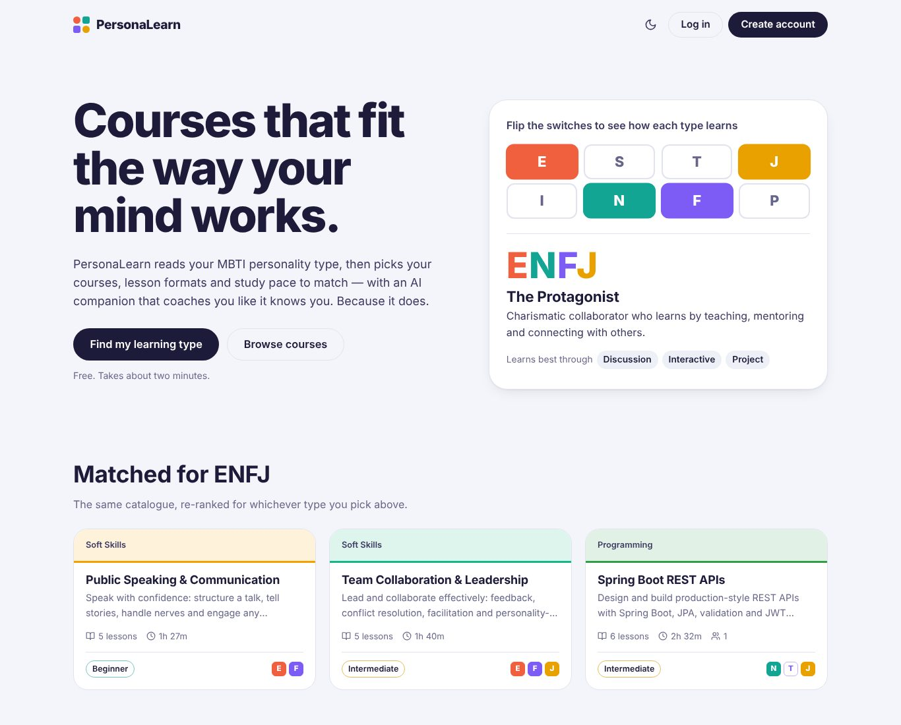
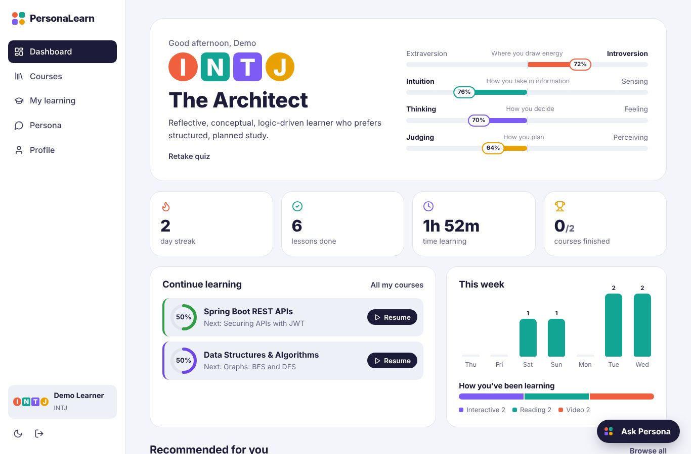
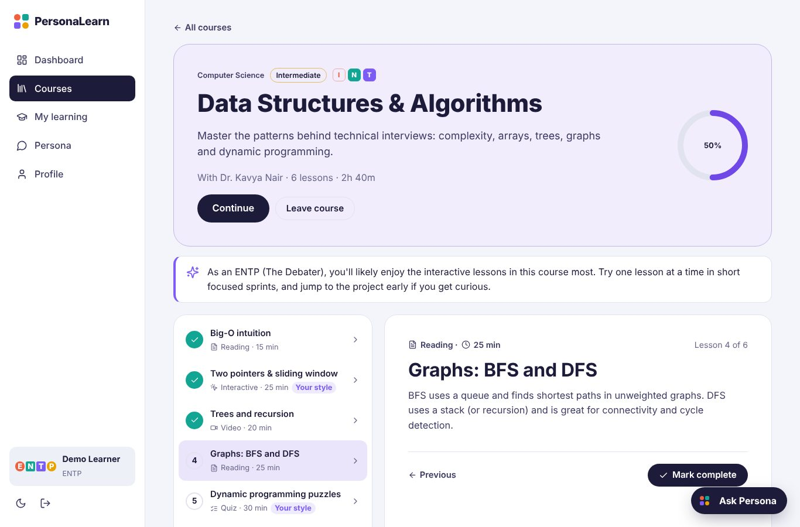
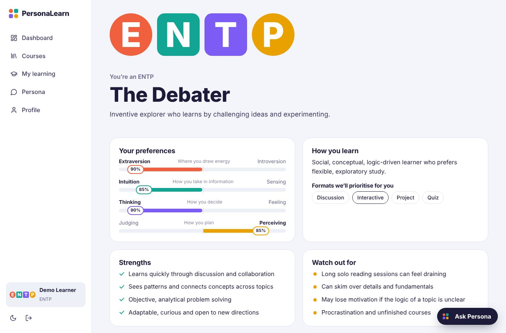
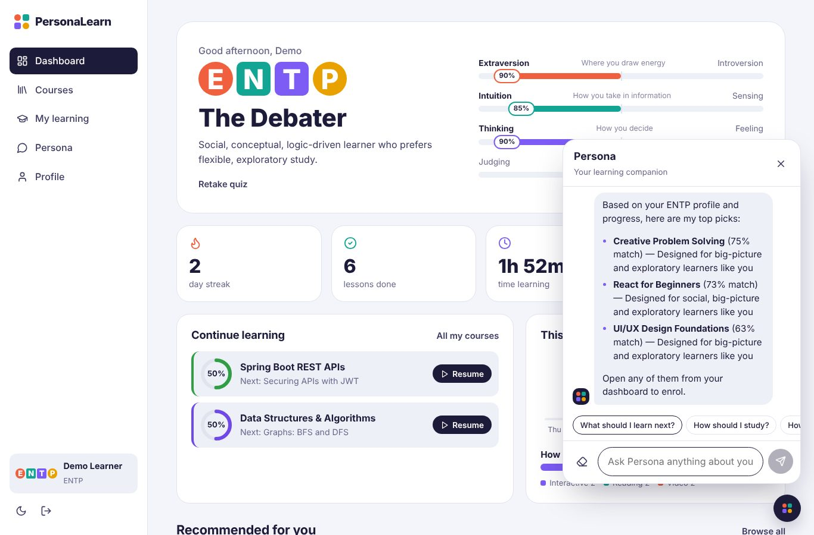

# PersonaLearn — MBTI-Based LMS Platform

**ReactJS · Java (Spring Boot) · JWT Authentication · MySQL**

PersonaLearn is a personality-driven learning management system. Learners take an MBTI assessment, and the platform adapts course recommendations, lesson formats, study pacing and AI chatbot coaching to their personality type.



## Features

**Personality engine**
- 20-question Likert-scale MBTI assessment with a live preview of your type as you answer
- Preference strength per dichotomy (E/I, S/N, T/F, J/P) shown as percentage bars
- 16 type profiles: learning style, strengths, challenges, study tips and preferred lesson formats
- Option to enter a known type directly

**Adaptive learning recommendations**
Each course is scored 0–100% for the learner from four signals:

| Signal | Weight | How it works |
| --- | --- | --- |
| Personality fit | 50% | Overlap between the course's target traits and the learner's type, weighted by preference strength |
| Format fit | 30% | Share of lessons delivered in the learner's preferred formats (reading, video, interactive, discussion, project, quiz) |
| Level fit | 15% | Adapts to progress — after finishing a beginner course in a category, the intermediate one rises, and so on |
| Interest | 5% | Categories the learner already engages with |

Every recommendation comes with human-readable reasons ("Designed for reflective and analytical learners like you").

**AI chatbot — "Persona"**
- Floating chat widget on every page plus a full-screen chat
- Knows the learner's type, scores, progress, streak and recommendations
- Built-in intent-based tutor: course recommendations, study strategies, progress review, motivation, type explanations
- Optional: set `ANTHROPIC_API_KEY` on the backend and replies are generated by Claude with the learner's profile injected as context (falls back to the built-in tutor automatically)

**Authentication**
- Register / login with BCrypt-hashed passwords
- Stateless JWT (HMAC-SHA256) sent as `Authorization: Bearer <token>`
- Role-based access: `STUDENT` and `ADMIN`

**Course management**
- Public catalogue with search, category and level filters, and a "strong fit for my type" toggle
- Course pages with lesson list, in-page lesson reader (Markdown), and a personalised tip for your type
- Admin panel: create / edit / delete courses and lessons, platform stats, learner distribution by type

**Progress tracking**
- Enrol / leave courses, mark lessons complete or undo
- Dashboard: streak, lessons completed, time learned, weekly activity chart, format breakdown, continue-learning queue
- Course completion celebration 🎉

**UI**
- Responsive from 360px phones to wide desktops (sidebar on desktop, bottom nav on mobile)
- Light and dark themes, keyboard shortcuts in the quiz (1–5), visible focus states, reduced-motion support

| Dashboard | Course |
| --- | --- |
|  |  |
| **Quiz result** | **Persona chatbot** |
|  |  |

## Tech stack

| Layer | Technology |
| --- | --- |
| Frontend | React 18, React Router 6, Axios, Vite, custom CSS (no UI framework) |
| Backend | Java 17, Spring Boot 3.3, Spring Security, Spring Data JPA, Bean Validation |
| Auth | JWT (jjwt 0.12), BCrypt |
| Database | MySQL 8 (H2 in-memory available for zero-setup development) |
| AI | Built-in rule-based tutor, optional Anthropic Claude API |

## Project structure

```
personalearn/
├── backend/                         Spring Boot REST API
│   └── src/main/java/com/personalearn/
│       ├── config/                  Security, CORS, error handling, seed data
│       ├── controller/              REST endpoints
│       ├── dto/                     Request / response records
│       ├── model/                   JPA entities (User, Course, Lesson, Enrollment, LessonProgress, ChatMessage)
│       ├── repository/              Spring Data repositories
│       ├── security/                JWT service and filter
│       └── service/                 MBTI engine, recommendations, progress, chatbot
└── frontend/                        React app
    └── src/
        ├── components/              Layout, chat, type glyph, axis bars, course card…
        ├── context/                 Auth, theme, toasts
        ├── pages/                   Landing, auth, quiz, dashboard, courses, course, chat, profile, admin
        └── lib/                     MBTI constants and helpers
```

## Running locally

### Prerequisites
- Java 17+ and Maven 3.9+
- Node.js 18+
- MySQL 8 (optional — see the H2 option below)

### 1. Database
Start MySQL. The database `personalearn` is created automatically on first run. Defaults are `root` / `root` on `localhost:3306`; override them with environment variables:

```bash
export DB_URL="jdbc:mysql://localhost:3306/personalearn?createDatabaseIfNotExist=true&useSSL=false&allowPublicKeyRetrieval=true&serverTimezone=UTC"
export DB_USERNAME=root
export DB_PASSWORD=yourpassword
```

### 2. Backend
```bash
cd backend
mvn spring-boot:run
```
The API runs on http://localhost:8080. Tables are created and demo data is seeded on first start.

No MySQL handy? Run with the in-memory H2 profile instead:
```bash
mvn spring-boot:run -Dspring-boot.run.profiles=dev
```

### 3. Frontend
```bash
cd frontend
npm install
npm run dev
```
Open http://localhost:5173. The dev server proxies `/api` to the backend.

### Demo accounts
| Role | Email | Password |
| --- | --- | --- |
| Student (INTJ, with progress) | demo@personalearn.com | demo123 |
| Admin | admin@personalearn.com | admin123 |

### Tests
```bash
cd backend
mvn test
```
`ApiFlowTest` runs the full learner journey end-to-end: register, MBTI assessment, recommendations, enrolment, progress, chatbot and admin permissions.

## Configuration

| Variable | Default | Purpose |
| --- | --- | --- |
| `SPRING_PROFILES_ACTIVE` | `mysql` | `mysql` or `dev` (H2) |
| `DB_URL`, `DB_USERNAME`, `DB_PASSWORD` | local MySQL | Database connection |
| `JWT_SECRET` | _(random per start)_ | HMAC key, at least 32 characters. Set it via environment variable; if unset, a random key is generated on startup |
| `JWT_EXPIRATION_MS` | `86400000` | Token lifetime (24 h) |
| `CORS_ALLOWED_ORIGINS` | `http://localhost:5173,http://localhost:3000` | Comma-separated frontend origins |
| `SEED_DATA` | `true` | Seed demo users and courses on first start |
| `ANTHROPIC_API_KEY` | _(empty)_ | Enables Claude-powered chatbot replies |
| `AI_MODEL` | `claude-haiku-5-5` | Model used when the API key is set |
| `VITE_API_URL` (frontend) | `/api` | API base URL for production builds |

> **Secrets:** API keys and the JWT secret are read only from environment variables and are never stored in the code. Don't commit `.env` files — they're already in `.gitignore`.

## API overview

| Method | Endpoint | Auth | Description |
| --- | --- | --- | --- |
| POST | `/api/auth/register` | — | Create account, returns JWT |
| POST | `/api/auth/login` | — | Log in, returns JWT |
| GET / PUT | `/api/auth/me` | User | Current user / update name |
| PUT | `/api/auth/password` | User | Change password |
| GET | `/api/mbti/questions` | — | Assessment questions |
| GET | `/api/mbti/types`, `/api/mbti/types/{type}` | — | Type profiles |
| POST | `/api/mbti/submit` | User | Score answers and save type |
| PUT | `/api/mbti/type` | User | Set a known type |
| GET | `/api/courses?search=&category=&level=` | — | Catalogue |
| GET | `/api/courses/{id}` | Optional | Course, lessons, progress, personalised tip |
| POST / DELETE | `/api/courses/{id}/enroll` | User | Enrol / leave |
| PUT / DELETE | `/api/lessons/{id}/complete` | User | Mark lesson complete / undo |
| GET | `/api/my/courses` | User | Enrolments with progress |
| GET | `/api/dashboard` | User | Stats, activity, recommendations |
| GET / POST / DELETE | `/api/chat` | User | Chat history / send message / clear |
| GET | `/api/admin/stats` | Admin | Platform stats |
| POST / PUT / DELETE | `/api/admin/courses[/{id}]` | Admin | Manage courses |
| GET / POST | `/api/admin/courses/{id}/lessons` | Admin | List / add lessons |
| PUT / DELETE | `/api/admin/lessons/{id}` | Admin | Edit / delete lessons |

## License

MIT
